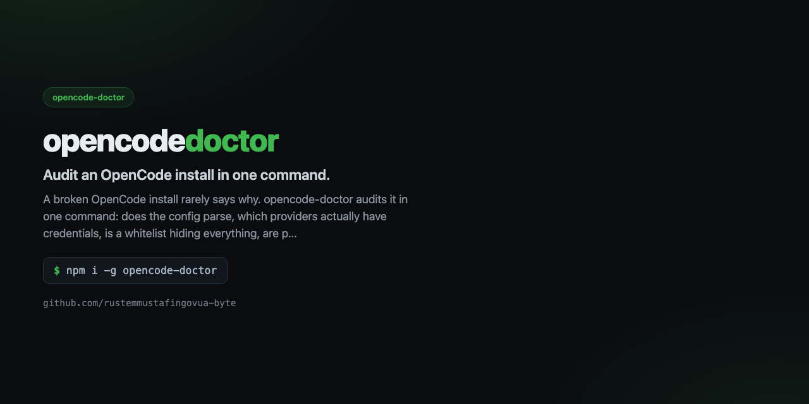

<div align="center">



# opencode-doctor

**Audit an OpenCode install in one command.**

[](https://github.com/rustemmustafingovua-byte/opencode-doctor/actions/workflows/ci.yml)
[](https://www.npmjs.com/package/opencode-doctor)
[](./LICENSE)
[](https://nodejs.org)
[](https://base.org)

[**Docs**](https://rustemmustafingovua-byte.github.io/opencode-doctor/) · [Issues](https://github.com/rustemmustafingovua-byte/opencode-doctor/issues) · [Discussions](https://github.com/rustemmustafingovua-byte/opencode-doctor/discussions)

</div>

---

A broken OpenCode install rarely says why. opencode-doctor audits it in one command: does the config parse, which providers actually have credentials, is a whitelist hiding everything, are paid models still in the picker, do the MCP servers point at files that exist.

## Install

```bash
npm i -g opencode-doctor
```

## What it does

| | |
|---|---|
| **Config validation** | JSONC with comments and trailing commas |
| **Credential audit** | env, auth.json and {file:} references |
| **Picker audit** | how many models are visible, how many are paid |
| **Asset inventory** | MCP servers, skills, agents, commands, plugins |


## Usage

```bash
opencode-doctor
opencode-doctor --config ~/.config/opencode/opencode.jsonc --json
```

## CLI

```
opencode-doctor — Audit an OpenCode install in one command.

USAGE
  opencode-doctor
  opencode-doctor --config ~/.config/opencode/opencode.jsonc --json

COMMANDS / OPTIONS
  --config <path>  config file to audit (default ~/.config/opencode/opencode.jsonc)
  --json           machine-readable output

Exit code 1 when the install has an error-level finding.

MIT · https://github.com/rustemmustafingovua-byte
```

## Part of a portfolio

| Project | What it does |
|---|---|
| [`opencode-free-stack`](https://github.com/rustemmustafingovua-byte/opencode-free-stack) | route to free models, fall back automatically |
| [`free-web-mcp`](https://github.com/rustemmustafingovua-byte/free-web-mcp) | web search for agents, zero credits |
| [`agent-x402`](https://github.com/rustemmustafingovua-byte/agent-x402) | pay per API call in USDC with a spend policy |

## Donate

MIT, forever. USDC on Base:

```
0x8aC6a229f254980CCd3Dd35CF5E1B7c08880B40E
```

## License

MIT © rustemmustafingovua-byte
